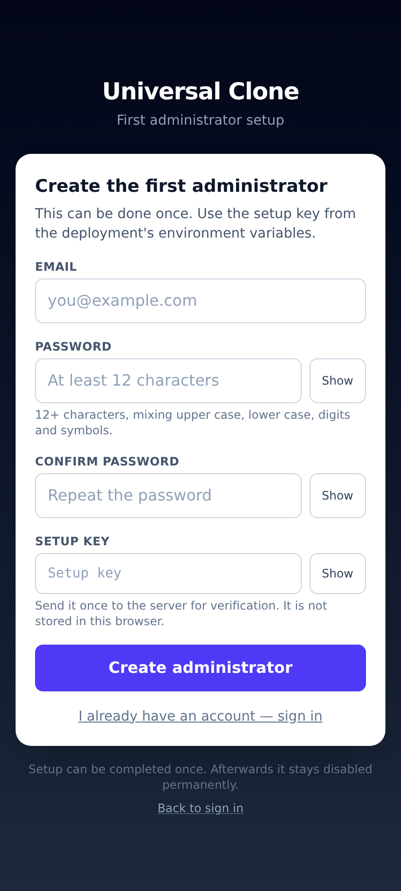
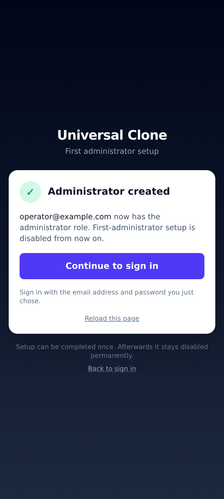

# First administrator setup (browser, no terminal)

Universal Clone normally creates accounts with the command-line tool `npm run user:create`. On a hosted
deployment such as Vercel you may not have a terminal — so V3.1.1 adds a one-time, browser-based setup
for the **first administrator**, protected by a server-side secret.

There is exactly one page and two API routes:

| Route | What it does |
|---|---|
| `GET /setup-admin` | The setup page (mobile-first). Rendered on the server; it only learns *whether* setup is available. |
| `GET /api/auth/setup` | `{ setupAvailable, state, message }`. Never returns the key. |
| `POST /api/auth/setup` | `{ setupKey, email, password, confirmPassword }` → creates the first administrator, once. |

The existing authentication is untouched: the account is written to the same `users` table with the same
scrypt password hashing, signs in through the same `POST /api/auth/login`, receives the same session
cookie, and gets `role = "admin"`.

---

## 1. Generate a setup key

Any of these (on any computer, phone app or password manager), 32+ characters:

```text
openssl rand -base64 48
python3 -c "import secrets; print(secrets.token_urlsafe(48))"
```

Use a **new random value** — the server refuses obvious placeholders (`changeme`, `example`, …) and values
made of fewer than 12 distinct characters. Keep it in your password manager; it is shown only while you
need it.

## 2. Set it in Vercel

1. Open <https://vercel.com> → select the **Universal-clone** project.
2. **Settings** (top navigation) → **Environment Variables** (left sidebar).
3. **Key**: `ADMIN_SETUP_KEY` — exact spelling, upper case, no quotes.
4. **Value**: paste the generated secret (32+ characters).
5. **Environments**: tick **Production** (and **Preview** / **Development** only if you want the same
   setup available there).
6. **Save**.
7. **Deployments** → the newest deployment → **⋯** → **Redeploy** (environment variables are only read by
   a new deployment).

The value is a server-only secret: it is read inside the API route, compared in constant time, and never
sent to a browser, stored in the database, or written to a log.

## 3. Open the setup page

On the phone:

```text
https://universal-clone7.vercel.app/setup-admin
```

The page shows the form only if `ADMIN_SETUP_KEY` is configured *and* no administrator exists yet.
Otherwise it explains why setup is unavailable (no key / key too weak / already completed).



Fill in:

| Field | Requirement |
|---|---|
| Email | A valid address; it becomes the administrator's sign-in name. |
| Password | 12–200 characters, at least three of: lower case, upper case, digits, symbols. Must not contain the email's local part. |
| Confirm password | Must match exactly. |
| Setup key | The value from step 2 (pasted, shown as dots; **Show** reveals it if needed). |

Tap **Create administrator**. On success the page confirms the account



and offers **Continue to sign in**
(`/`), where you sign in with the new email and password. The account has the `admin` role and can open
`/api/admin/overview`, which normal accounts cannot (they get `403`, anonymous visitors `401`).

If the database schema was never migrated, the setup route creates only its own marker table
(`admin_setup`) inside the transaction. It never creates, alters or drops the `users` table.

## 4. Why setup cannot be used twice

* A marker row `admin_setup(id = 'first-admin')` is written in the **same transaction** that inserts the
  administrator, under a PostgreSQL advisory lock (`pg_advisory_xact_lock`).
* After that, `GET /api/auth/setup` answers `state: "completed"` and `POST` answers **409**.
* The check is repeated on the server for every request: the page never decides.
* It stays disabled even if the administrator account is later deleted (the marker's `user_id` is nulled,
  not cascaded).
* Any pre-existing `role = 'admin'` row (for example one created earlier with `npm run user:create`) also
  disables setup.
* Two simultaneous submissions are serialised by the lock: exactly one gets `201`, the other `409`
  (covered by a test).

## 5. Remove the key afterwards (recommended)

1. Vercel → Project → **Settings** → **Environment Variables**.
2. `ADMIN_SETUP_KEY` → **⋯** → **Delete** (or remove it from each environment).
3. **Deployments** → newest → **⋯** → **Redeploy**.

`/setup-admin` then shows "Setup is disabled: ADMIN_SETUP_KEY is not configured on the server", and
`POST /api/auth/setup` answers `503`. This is a second lock on top of the completion marker: even if the
marker table were dropped, no one could create an administrator without the key.

## 6. If the administrator loses the password

There is no password-reset email flow (see [LIMITATIONS.md](LIMITATIONS.md)). Options, in order of
preference:

1. **Another administrator resets it** — not possible for the first admin unless you created more admins.
2. **Recover with the key still set** — restore access without a terminal:
   1. Delete the administrator row in the database (Neon SQL editor → your branch → **SQL Editor**):
      ```sql
      -- read it first so you know what you are removing
      SELECT id, email, role, created_at FROM users WHERE role = 'admin';
      -- this also deletes the account's jobs and archives rows (ON DELETE CASCADE)
      DELETE FROM users WHERE id = '<the id above>';
      -- remove the completion marker so setup may run again
      DELETE FROM admin_setup WHERE id = 'first-admin';
      ```
   2. Open `/setup-admin` again with `ADMIN_SETUP_KEY` still configured and choose a new password.
   3. Remove the key again (section 5).
3. **Operator with a terminal** — no database edits needed:
   ```bash
   DATABASE_URL=… npm run user:create -- you@example.com admin
   ```
   (It creates a *new* account; delete the old one first if the address must be reused.)
4. **Last resort** — if the key was removed *and* the marker still exists, set a fresh `ADMIN_SETUP_KEY`,
   redeploy, and follow option 2. Without the key, no administrator can be created from the browser; that
   is the intended trade-off.

> Re-issuing access is always an operator action. The setup endpoint itself can never be used to create a
> second administrator: once the marker exists it answers `409` even with the correct key.

## 7. Troubleshooting

| What you see | Why | Fix |
|---|---|---|
| `Setup is disabled: ADMIN_SETUP_KEY is not configured` | Variable missing, or the deployment predates it | Add it and **redeploy** |
| `ADMIN_SETUP_KEY must be a random secret of at least 32 characters` | Too short, too few distinct characters, or a placeholder word | Generate a new one |
| `First administrator setup is already complete` (409) | An admin or the marker already exists | Sign in with that account |
| `The setup key is not correct` (403) | Wrong key (trailing space, wrong environment, stale deployment) | Re-copy the value, redeploy |
| `Choose a stronger password: …` (400) | Password policy | Follow the message |
| `Too many setup attempts` (429) | 5 attempts / 15 min per client, 100 / 15 min globally | Wait 15 minutes |
| `Internal server error` (500) | Usually the database (`DATABASE_URL`, `DATABASE_SSL`, migrations) | Check `/api/health`, run `npm run db:migrate` |

## 8. Security summary

* The key is server-side only, never bundled into client JavaScript (verified: `ADMIN_SETUP_KEY` appears in
  no `.next/static` file) and never logged or returned.
* Minimum length 32, plus an entropy and placeholder check; comparison is timing-safe (both sides are
  hashed with SHA-256 before `timingSafeEqual`, so length and prefix do not leak).
* CSRF/cross-origin: `Sec-Fetch-Site`/`Origin` must be same-origin (`assertSameOrigin`, honouring
  `APP_ORIGIN`), and the body must be `application/json`, which a HTML form cannot send.
* Rate limits in PostgreSQL (shared by all instances): 5 attempts / 15 min per client address and
  100 / 15 min overall.
* One transaction, one advisory lock, one admin: the "does an administrator exist?" check and the insert
  are atomic, so the endpoint cannot be raced into a second administrator.
* Passwords: the existing scrypt scheme (`scrypt$N$r$p$salt$key`) — same format as every other account, so
  the existing sign-in path verifies them unchanged.
* No email, password or key is ever hardcoded; there is no default account.
